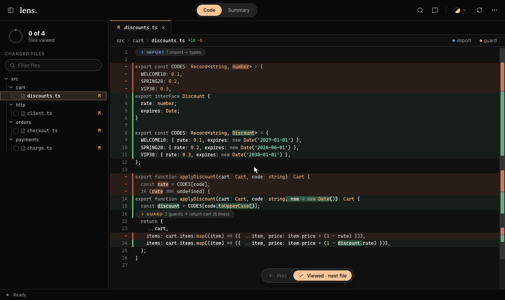
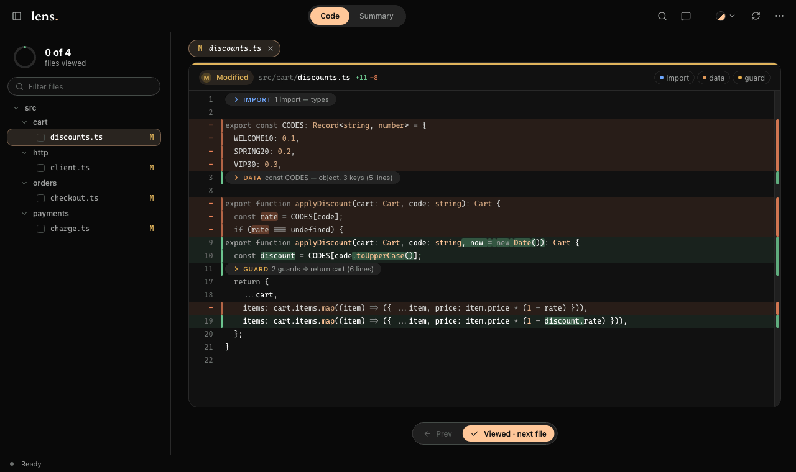
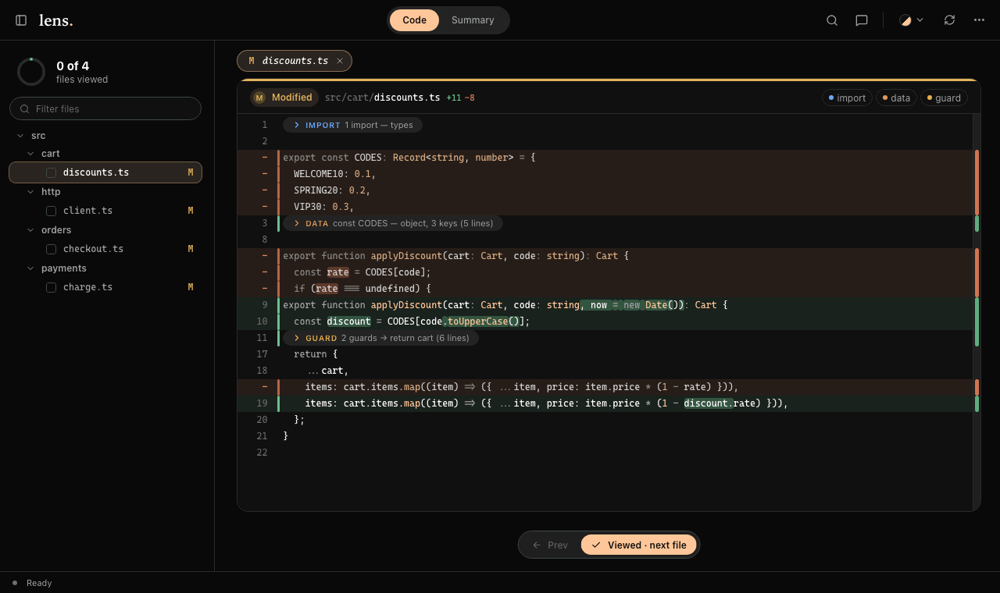

# lens

**The code review tool for the agentic era.**

Agents write code faster than anyone can read it. lens makes the reading fast: it folds away
the noise, has your own coding agent brief you on the change function by function, and lets
you ask it questions while you read. lens itself never calls an AI and needs no API key.


**Contents:** [What it does](#what-it-does) · [Install](#install) · [Quick start](#quick-start) ·
[Command line](#command-line) · [The viewer](#the-viewer) · [Summary mode](#summary-mode) ·
[Ask mode](#ask-mode) · [Plan mode](#plan-mode) · [How folding works](#how-folding-works) ·
[Configuration](#configuration) · [Development](#development) · [Non-goals](#non-goals)

## What it does

| | what it does | who does the work |
| --- | --- | --- |
| **Code view** | Folds what carries no review signal (imports, doc comments, guards, logging, boilerplate), so you see where the behavior lives. | lens: tree-sitter and rules, no AI |
| **Summary view** | One changed function at a time: a headline, concerns, what behaves differently, callers it may break. | your agent writes it, lens checks it |
| **Ask** | Ask about the code you're reading. Answers cite `path:line`. | your agent answers, lens checks the cites |
| **Plan view** | Your [Lavish](https://github.com/kunchenguid/lavish-axi) plans inside lens: annotate, answer, press Build it. | your agent writes them with Lavish |

**Fold the noise.** Folds are one-line pills that say what they hide, one click from the code.



**Ask while you read.** The question goes to your agent with the change and its concerns; the answer cites the lines.



**Any code theme.** The whole page follows it, dark or light.



## Install

**macOS app**: download `Lens-darwin-arm64.zip` from the
[latest release](https://github.com/miha53cevic/lens/releases/latest), move `Lens.app` to
`/Applications`, and clear the download mark once (the app isn't notarized):

```bash
xattr -dr com.apple.quarantine /Applications/Lens.app
```

**From source** (needs [Bun](https://bun.com) >= 1.4 and git):

```bash
bun install
bun run app             # run the desktop app from this checkout
bun run app:dist        # or pack it for this machine into release/
```

In the app, **Settings → Agent** installs the `lens` command and the agent skills
(`/lens-review`, `/lens-build-review`, `/lens-ask`), and removes them again.

## Quick start

Open the desktop app and pick a repository and what to review: the working tree, staged
changes, a branch against a base, any `git diff` arguments, or a PR. Each repository gets a
tab, and the app reopens as you left it. **Git worktrees** are repositories of their own: the
picker's branch menu lists the others and opens one in a tab beside this one, and Start lists
them under their repository. Then, in your agent:

```bash
/lens-review            # writes the Summary tab; same arguments as `lens diff`
```

## Command line

The app runs the `lens` command for you, and the skills call it too. You can run it yourself.

| command | what it opens or prints |
| --- | --- |
| `lens <path…>` | files or directories, folded |
| `lens diff` | the worktree against the index, new untracked files included |
| `lens diff --staged` | staged changes |
| `lens diff HEAD~1` | any `git diff` arguments pass through |
| `lens pr 123` / `lens pr <url>` | a GitHub PR, fetched with plain git (no API, no gh) |
| `lens info` | what could be reviewed here: the branch, its changes, the PR remote, the other worktrees |
| `lens config` | the config in effect, where each value comes from, and its problems (`--json` for scripts) |
| `lens clear` | what lens keeps in `.lens/`, by kind; `lens clear <kind> --all` (or one review's `<key>`) clears `summaries`, `notes`, `marks` or `timings` |
| `lens timings` | how long each step took, while timings are on, in every repository (`--repo <name>` for one, `--json` for every one) |

| flag | meaning |
| --- | --- |
| `--port <n>` | the viewer's port (default: one per repository, from 5400 up) |
| `--no-open` | don't open the browser |
| `--summary` | open on the Summary tab |
| `--fold-level <n>` | fold regions with a score up to `n`, `-1` for none |
| `--theme <name>` | any [Shiki theme](https://shiki.style/themes) |
| `--json` | print the fold model as JSON, for debugging |
| `--version` | print lens's version |

Loose files and these flags are CLI-only; the app's picker covers the diff and PR modes.

## The viewer

- **Diff reading**: hunks only, inline removed lines, word diff, side by side, hide tests.
- **Search** in files (⌘P), by path (⌘⇧P), ⌥-click for usages.
- **TypeScript** (Settings → Feature flags, off by default): a name's type and doc on hover, ⌘-click (Ctrl elsewhere) to its definition. lens runs the repository's TypeScript 7 (`tsc --lsp`), and only on files whose text on disk is the code shown.
- **Viewed marks** and a progress ring, kept per review in `.lens/marks/`.
- **Notes** on a line or selection (right-click), kept per review in `.lens/notes/`, and copied along for your agent.
- **Settings** (`,`, or ⋯ → Settings): General (code and UI size), Code (fold level, diff reading), Summary, Feature flags, Debug, and the config in effect.
- **Reload** (`r`) re-runs the analysis; the status bar says when the code changed on disk.
- **Clear saved data** (⋯ menu): summaries, notes, marks and timings, for this review or all. Settings stay.
- **Timings** (Settings → Debug, on by default): lens records how long its steps take, in every repository, in `~/.lens/timings.jsonl` (with the machine each run ran on): `lens timings` lists them, and the file is what to send when lens is slow.

Press `?` in the viewer for every key.

## Summary mode

The Summary tab walks the diff one unit (function, component, hook, method, type) at a time:
a headline, **concerns** (possible bugs, risks, questions, each with its trigger and the
smallest fix), what behaves differently, and callers it may break. Mark each concern
*real* or *dismiss* it, and copy the real ones back to your agent. Units are grouped into
**flows**, one story each, ranked P1 to P3, under an overview of the whole diff.

```bash
/lens-review --staged           # in your agent; or: pr 87
```

- **Build previews** (Settings → Summary, on by default): the agent also draws the screens a UI diff
  changes, and **sequences** of what now happens at run time. Previews run sandboxed.
- **Check yourself** (Settings → Summary, off by default): a few questions per flow, answer behind a click.
- **Full units** (Settings → Summary): the rest of a unit's file above and below it.

The skill runs `lens summary prepare` (splits the diff, writes the agent's instructions) and
`lens summary submit` (checks the result). Any agent with a shell can follow them. `submit`
drops claims that don't point at real code, and a summary goes stale when its code changes.
A branch diff is summarized with that branch checked out (in another worktree, it is
summarized there); a PR from any branch.
`/lens-build-review` does the whole review step after an agent's build.

## Ask mode

Press `a` to ask about the open change, with your selection and its open concerns along. Run
`/lens-ask` in your agent to answer: it only reads, never edits, and lens checks each
`path:line` cite. With no agent listening, a question copies as a prompt for any chat.

## Plan mode

The Plan tab (`p`; on by default, off in Settings → Feature flags or with `planTab`) lists the
[Lavish](https://github.com/kunchenguid/lavish-axi) plans in `.lavish/` and opens Lavish's
editor in the tab, so annotating, sending feedback and pressing **Build it** happen in lens.
**New plan** makes a `/lavish …` command for your agent. With the tab on, `lens diff` on a
clean branch opens on the Plan tab: start a feature there, refresh to review what got built.
It needs Lavish's skill (`npx skills add kunchenguid/lavish-axi --skill lavish -g`) and Node 22+.

## How folding works

Each region gets a category and a score (0–3) and folds when its score ≤ the fold level
(default 1, changed live in Settings → Code). TODO/FIXME comments and `lens:keep` regions never fold.

| category            | what folds (conservatively) |
| ------------------- | --------------------------- |
| `import`            | contiguous imports and `export … from` re-exports |
| `comment`           | whole-line comments and doc blocks. Work markers and suppressions stay visible |
| `guard`             | an else-less `if` whose body only exits (throw/return/continue/break), optionally with a log line |
| `logging`           | `console.*` / `logger.*` calls whose result is unused and whose arguments do no work |
| `telemetry`         | fire-and-forget `metrics.*` / `telemetry.*` / `analytics.*` calls |
| `error-boilerplate` | catch blocks that only log and/or rethrow |
| `accessor`          | getters/setters that only return or store a value, and one-statement delegation methods |
| `barrel`            | files that are only imports and re-exports |
| `data`              | pure-literal constants: lookup maps, option objects, literal enums |

Folding works on ts, tsx and js. Other files get change markers and syntax colors.

## Configuration

lens's rules are [lens.defaults.json](lens.defaults.json). The nearest `.lens.json` merges
over it: scalars override, maps merge, lists extend, `"!x"` removes `x` from a list, and
`"base": false` makes your file the whole rule set.

```json
{
  "foldLevel": 0,
  "folds": { "logging": false, "guard": 2 },
  "callPatterns": [{ "category": "audit", "receivers": ["audit", "featureFlags"] }],
  "keepCommentMarkers": ["SECURITY"],
  "exclude": ["generated/**", "!*.map"]
}
```

A value that doesn't check is skipped and the rest applies; lens, the status bar, Settings
and `lens config` all say why.

| field | meaning |
| ----- | ------- |
| `foldLevel` | fold regions with score ≤ this, `-1` for none (default `1`) |
| `theme` | the Shiki theme the viewer starts in (default `"vesper"`) |
| `folds` | per category, its score (0–3) or `false` to never fold it; one not named scores 1 |
| `callPatterns` | fire-and-forget calls to fold: `{ category, receivers, methods?, score? }` |
| `keepCommentMarkers` | comments containing these never fold |
| `keepDirective` | a region containing it, or right below it, never folds (default `"lens:keep"`) |
| `testFilePatterns` | what *hide tests* hides, and what summary mode treats as tests |
| `exclude` | listed in a diff as `⊘` without being read; skipped in directory walks |
| `buildPreviews` | summary mode asks for previews and sequences (default `true`) |
| `selfChecks` | summary mode asks for questions to check yourself with (default `false`) |
| `planTab` | the viewer shows the Plan tab (default `true`) |
| `typescriptLsp` | the viewer asks TypeScript 7's language server about the code under the pointer (default `false`) |
| `timings` | lens records how long its steps take, for `lens timings` (default `true`) |

Settings' switches override the last five for you, in `~/.lens/settings.json` (your home
folder, on macOS and Windows alike), which also keeps how you left the viewer (view settings,
fold level, panels), and the timings: the same in every repository. What belongs to a repository stays in its
`.lens/` (summaries, marks, notes) and `.lavish/`. Patterns:
`*` matches within a path segment, `**` across them, anywhere in the path. The old names
(`threshold`, `categories`, `scores`) still work, with a problem saying what to rename.

## Development

```bash
bun run test        # typechecks, format check, bun test
bun run app         # the desktop app (Settings → Sandbox shows the design system)
bun run app:smoke   # the app's scripted tour, with pictures in dist/smoke
bun run compile     # lens as one executable, in dist/lens (what the packed app runs)
```

Sources: `src/cli-app/` (the command and server), `src/ui/` (the design system),
`src/viewer/` (the viewer page), `src/desktop/` (the Electron app). Releases go through
release-please: merging its release PR publishes the macOS app.

## Non-goals

- **No AI calls.** Summary, ask and plan mode hand the writing to your own agent.
- **No editing.** lens is read-only.
- **No terminal UI.** The viewer is the interface (`--json` is for debugging).
